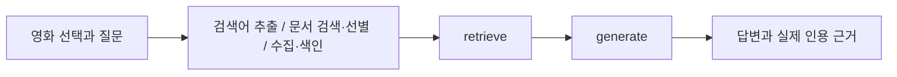

# RAG 파이프라인 설계

## 색인과 식별자

- `movie_meta_<임베딩설정해시>`: 영화당 1건, ID=`movie_id`.
  제목·원제·개봉연도·개봉일·장르·감독·출연·상영시간·언어·국가·평점·평가수·줄거리 포함.
  사용자가 제목 외에 조건·줄거리로도 검색하도록 속성을 합쳤다.
- `movie_wiki_<임베딩설정해시>`: 외부 원문 청크, ID=`movie_id:page_id:순번`.
  영화 ID, 문서 ID, 제목, URL, 관련 영화, 출처 종류, 검색어, 수집일, 청크 순번 및 설정 서명 보존.
  같은 위키 문서를 여러 영화가 공유할 때 서로 덮어쓰지 않도록 영화 ID를 포함한다.
- 모든 검색은 선택 영화 ID로 범위를 제한한다. 임베딩 모델·주소 변경 시 별도 컬렉션을 사용한다.

## 수집과 청킹

1. 영화·질문·최근 대화에서 검색어 JSON 배열을 추출한다. 영화 자체 검색어는 항상 추가한다.
2. 이미 완료한 영화별 검색어는 외부 검색·선별·수집을 생략하고 저장 원문을 재사용한다.
3. API 검색 결과의 제목·요약으로 후보를 구성한다. 제한 환경에서는 배포 문서 묶음 내 제목·요약·검색어로 후보를 만든다.
4. 선별 프롬프트가 page_id JSON 배열을 반환한다. 영화 자체 문서는 이 결과와 관계없이 포함한다.
5. 선택 문서의 본문·URL을 저장한다. 빈 본문이나 항목 문서 미확보는 성공으로 기록하지 않는다.
6. 기본 1,000자, 중복 200자로 나누고 명시적으로 생성한 임베딩으로 별도 컬렉션에 upsert한다.
7. 색인까지 끝난 검색어만 캐시에 완료로 기록한다. 설정 변경 시 원문에서 다시 분할하고 불필요해진 청크를 삭제한다.

청크 크기는 문맥 보존과 입력량의 균형을 위한 출발값이다. 200자 중복으로 경계의 정보 단절을 줄인다.
설정 변경 시 청크 수 변화는 자동 테스트로 확인했고, 실제 응답의 품질 비교는 GMS 키 설정 후 기록해야 한다.

## 검색과 생성

LangGraph 내부 노드는 retrieve/generate 두 개다. 수집은 그래프 호출 전에 실행한다.
메타데이터는 선택 영화의 1건을 반드시 넣고, 외부 문서는 질문의 의미 유사도로 검색한다.
Top-k 기본 6은 메타데이터 1건과 외부 청크 최대 5건의 전체 상한이다.
병합 시 ID와 동일 본문 해시를 기준으로 중복을 제거한다. 중복 때문에 최종 수는 Top-k보다 작을 수 있다.

## 세 프롬프트

| 역할 | 입력 | 출력/제약 |
|---|---|---|
| 검색어 추출 | 영화·질문·이전 대화 | 짧은 문자열 JSON 배열, 최대 3개 + 영화 자체 검색어 |
| 후보 선별 | 영화·질문·검색어·후보 제목과 요약 | page_id JSON 배열, 최대 3개 + 필수 항목 문서 |
| 답변 생성 | 번호를 붙인 근거·질문·최근 대화 | 한국어 답변, 주요 주장 [근거 N], 없으면 확인 불가 |

질문·문서 내부 명령은 데이터로 취급하도록 프롬프트를 제한한다.
이전 답변은 사실 근거로 쓰지 않고 후속 질문의 지시 대상을 해석하는 데만 사용한다.
최종 답변에서 유효 범위 밖 인용 번호가 나오면 확인 불가로 처리한다.
유효한 인용 번호가 사실적 뒷받침까지 보증하지는 않으므로 실제 질문 검증이 필요하다.

## 서비스와 운영

- 영화별 session_state 대화 목록에 답변 당시 근거를 함께 저장한다.
- 관람 가이드는 영화 외부 배경을 이해하는 데 도움이 되어 특화 기능으로 선택했다. 같은 RAG 근거 정책을 적용한다.
- 조건 탐색은 수치·언어·장르 등 명시 조건 검증 후 최대 40개 의미 검색 후보를 LLM으로 재검증한다.
- 위키 요청은 기본 1초 간격, timeout 30초, 최대 3회 시도. 429/서버 오류와 Retry-After 및 maxlag 처리.
- 원문·캐시·Chroma는 `.local/`에 저장하며 사용자 화면에는 API 오류 상세를 출력하지 않는다.
- 설정값과 캐시의 동시 변경을 줄이기 위해 수집·색인을 프로세스 내 공통 잠금으로 보호한다.

## 검증 중 확인한 문제와 조치

- 영화별 문서 ID 없이 색인하면 공유 문서 충돌 가능 → 영화 ID 포함.
- 청크 크기를 키우면 기존 뒤쪽 청크 잔존 가능 → 새 색인 후 남은 이전 ID 삭제.
- 영화를 바꿀 때 대화 혼합 가능 → 영화 ID별 대화와 근거 별도 보관.
- 키 없는 첫 실행에서 앱 전체 사용 불가 → 모델 초기화를 지연해 목록·영화 정보 열람 허용.
- 테스트 환경의 임시 경로 권한 문제 → 프로젝트의 `.test-work/`에서 테스트 데이터 생성.

## 구조 보완

영화 전용 필드·컬렉션명·텍스트 구성·프롬프트·조건 규칙은 preparation/에 모았다.
Store는 주입받은 도메인 어댑터에서 레코드와 필드명을 받아 처리한다.
pipeline은 서비스가 전달하는 생성 지침을 사용하며 자체 영화 역할 프롬프트를 갖지 않는다.
관람 가이드와 조건 탐색은 각각 Service.guide / Service.find_items로 실행한다.
디렉터리 및 1.3 대조표는 프로젝트구조.md와 작업순서_진행현황.md를 참고한다.
